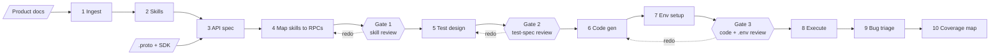

# ai-regression-agent

**Turn product docs into traceable end-to-end regression tests, with human review gates, and keep them in sync when the docs change.**

Built with [LangGraph](https://github.com/langchain-ai/langgraph) (orchestration, checkpoints, human-in-the-loop) and the [Anthropic SDK](https://github.com/anthropics/anthropic-sdk-python) (Claude for the language-heavy steps). It ships with a small demo gRPC service, **Shelfwise**, that has four planted bugs, so you can watch the agent find them.


## Why doc-driven tests

Tests written by reading the code check that *the code does what the code does*. If the implementation misunderstood the requirement, the test inherits the misunderstanding. This agent derives every test from the **requirements**, so it checks that *the code does what it was promised to do*. Every test traces back to a requirement ID and the exact doc line it came from.

It also fixes the usual problems with hand-written suites:

- **No traceability.** Each skill, test and bug report points back to a requirement and a doc line.
- **Stale tests.** When docs change, `diff-runner` finds exactly which tests are affected and regenerates only those.
- **Hidden gaps.** Every run ends with a coverage map: uncovered requirements, API methods nothing calls, low-confidence tests.

## How it works



| # | Stage | What it does | Output |
|---|---|---|---|
| 1 | Ingest | Byte-exact copy of the docs (no AI, no network). Stops if the docs folder is empty | `manifest.json` (MD5 per doc, the baseline for diffs) |
| 2 | Skills | Splits docs into atomic user actions named `domain.noun.verb`. Edge cases go with their action ("split by action, not outcome"). Untestable lines are **logged, never dropped** | `skills.md`, `skill_traceability.json`, `excluded_actions.md` |
| 3 | API spec | Brace-balanced `.proto` parser, cross-checked against the SDK's wrapper methods | `grpc_spec.json` |
| 4 | Mapping | Deterministic verb/noun/service scoring. Claude settles only the ambiguous leftovers, and its answer is a JSON-schema **enum of real methods**, so it can't invent one | `skill_endpoint_map.json`, `skills_review.md` (Gate 1) |
| 5 | Test design | Directed skill graph (A → B when A produces an ID that B needs). Scenarios walk it: setup steps, the action, exact checks. Each test is scored 0–100 for confidence | `e2e_tests.json/.md` (Gate 2) |
| 6 | Code gen | Deterministic: one pytest file per spec. Methods are copied verbatim from the map and requests are validated against the spec, so **no invented calls or fields** | `tests/generated/test_e2e_NNN_*.py` |
| 7 | Env setup | Compiles stubs. Walks the generated code's syntax tree to find exactly which settings the tests read | `config.py`, `.env`, `env_review.md` (Gate 3) |
| 8 | Execute | Four pre-flight checks, then pytest. The harness records every call (request, response, status) as evidence | `test_logs/*.evidence.json`, `execution_results.json` |
| 9 | Triage | Rule cascade (ENV_ERROR / TEST_BUG / PLATFORM_BUG). Claude decides only the AMBIGUOUS cases. When unsure it defaults to PLATFORM_BUG (fail-safe). Failures with a shared cause are grouped | `triage.json`, `bug_reports/*.md` |
| 10 | Coverage | Six dimensions, including a reverse check of which real API methods were actually called | `coverage_map.json/.md`, `coverage_gaps.json` |

**Orchestration (LangGraph).**
- Each stage is a node. Artifacts live on disk, so a person can read and edit any of them.
- The three gates pause the graph with `interrupt()`. `rga approve` continues the run; `rga redo` re-runs the stage before the gate. A reviewer's edits to the skill map are kept.
- A SQLite checkpointer saves the run after every node, so a crash or Ctrl+C resumes at the first unfinished stage with no rework.
- `pipeline_config.json` holds everything platform-specific, so the orchestrator itself is platform-agnostic.

**Where Claude is used, and where it isn't.** The rule throughout is *deterministic first, the LLM only for what's left*. Claude extracts skills, settles ambiguous mappings, designs tests and judges ambiguous failures. Every call uses structured outputs (JSON schema), prompt caching for the stable system prompts, and server-side refusal fallbacks. Parsing, scoring, code generation, execution and coverage are plain Python.

### diff-runner: surgical updates when docs change

```
rga diff
```

1. Diffs the docs against `manifest.json` and re-extracts skills **only from changed docs**.
2. Classifies each skill as `unchanged` / `updated` / `obsolete` / `new` / `relocated` (same requirements in a renamed doc).
3. Diffs the API spec method by method. **Endpoint drift** (a changed RPC contract) invalidates the affected tests even if no doc changed.
4. Classifies each test as `VALID` / `UPDATE_REQUIRED` / `UNCERTAIN` / `OBSOLETE` / `NEW`.
5. Regenerates only `UPDATE_REQUIRED` and `NEW` tests. `VALID` and `UNCERTAIN` files are left byte-for-byte untouched (`UNCERTAIN` ones are flagged as stale for review), and `OBSOLETE` ones are deleted.
6. Re-runs the suite, triage and coverage, then resets its state for the next update.

## Quick start

Requires Python 3.10+.

```bash
git clone https://github.com/Samar-Anand-Pal/ai-regression-agent && cd ai-regression-agent
python -m venv .venv && source .venv/bin/activate
pip install -e ".[dev]"

rga run            # full pipeline on the Shelfwise docs; pauses at each gate
rga approve        # after reading the review file it points to (or: rga redo)
rga status         # per-stage status
```

- **With Claude:** set `ANTHROPIC_API_KEY` (or run `ant auth login`). The model is set in `pipeline_config.json` (default `claude-opus-5-5`).
- **Without a key:** the pipeline runs in **offline mode**. Every LLM step falls back to a deterministic heuristic; quality is lower, but everything runs, which is what CI uses. Force it with `--offline`; skip the gates with `--auto-approve`.

Try diff-runner (v1 docs → v2 docs + proto):

```bash
scripts/diff_demo.sh --offline
```

Point it at your own system by writing a `pipeline_config.json`:

```json
{
  "platform_name": "My service",
  "docs_path": "docs",
  "proto_path": "api/service.proto",
  "client_path": "sdk/client.py",
  "target": {"address": "localhost:50051", "reset_rpc": "TestSupport.Reset"}
}
```

## Results on the demo service

Measured in **offline mode** (no LLM), reproducible with `pytest` and the commands above:

| | Result |
|---|---|
| Docs → skills | 6 docs, 34 requirements → 24 skills in 6 domains; 7 untestable lines logged with reasons |
| API spec | 21 RPCs indexed (2 without an SDK wrapper, flagged) |
| Skill → RPC mapping | 24/24 mapped; 23 deterministic, 1 low-confidence flagged for Gate 1 |
| Tests designed | 24 tests, 2.4 skills per test on average; the 8 requirements offline mode can't design are listed with the reason |
| Against the buggy server | 23 pass, 1 fails → 1 bug report (REQ-014, suspended member can borrow) |
| Against the fixed server | **24/24 pass: no false positives** |
| diff-runner (v1 → v2) | 15 tests VALID and untouched, 4 UPDATE_REQUIRED (including 1 endpoint drift), 4 UNCERTAIN, 1 OBSOLETE, 1 new skill; 5 tests regenerated, 1 deleted |

Offline mode finds **1 of the 4** planted bugs (see [`sample_service/PLANTED_BUGS.md`](sample_service/PLANTED_BUGS.md)). The other three need an understanding of numbers and sequences ("25 cents per day late", "at most 2 renewals", "a returned copy is set aside for the next hold"), which is what the Claude test designer is for. Its results aren't in this table yet: run `rga run` with an API key against the buggy server to measure them.

## Project layout

```
src/regression_agent/
    graph.py           LangGraph orchestrator (10 stages, 3 gates, checkpoints, state.json)
    diff_runner.py     doc-diff + surgical update graph
    llm.py             Claude client (structured outputs, caching, fallbacks) / offline switch
    runtime.py         harness used by generated tests (refs, checks, evidence)
    stages/            ingest, skills, spec, mapping, design, codegen, envsetup, execute, triage, coverage
    cli.py             `rga` command
sample_service/        Shelfwise demo: .proto (v1, v2), docs (v1, v2), server with planted bugs, SDK client
tests/                 33 tests: stage units, Claude paths with a scripted fake, harness, service, end-to-end CLI
scripts/diff_demo.sh   the diff-runner demo
```

## Limitations

- gRPC unary calls only (no streaming).
- Offline mode handles common patterns (happy paths, unknown IDs, duplicates, numeric bounds, state setup like "a suspended member"), but not rules involving arithmetic or multi-actor sequences.
- Docs are expected as Markdown with requirement IDs (`**REQ-001**`). Other formats work with Claude, but traceability is weaker without IDs.

## License

MIT
